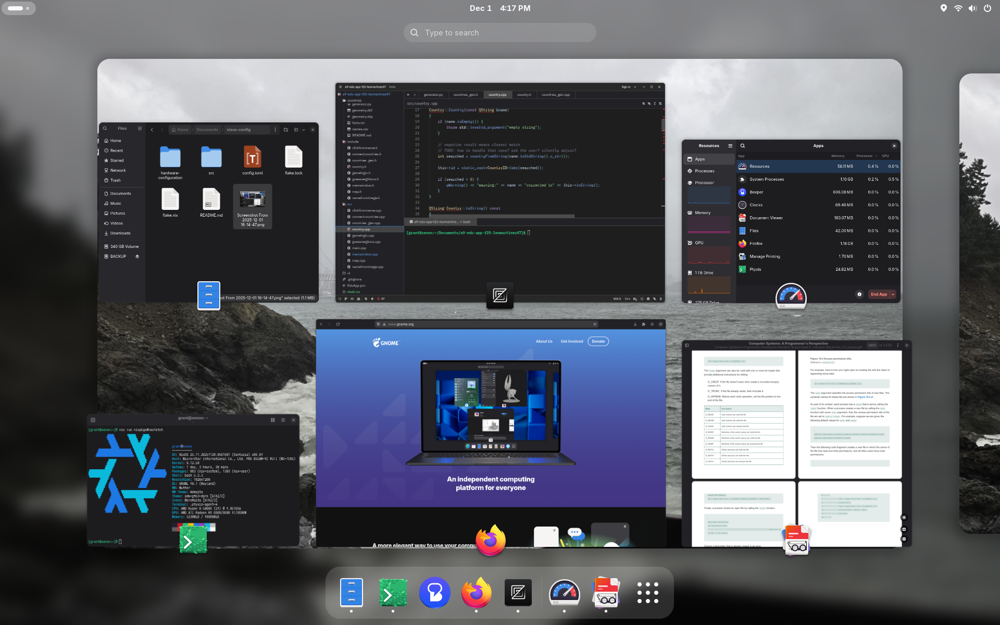

# a humble nixos config

This is my [NixOS](https://nixos.org) 26.05 configuration for my laptop, desktop, and homelab.

It includes a near-stock [GNOME](https://gnome.org) desktop environment with a few tweaks to make it a bit more cohesive.

Desktop features:

- Personal information configuration for user-specific settings
- Adwaita GTK3 and Qt theming with a blurred GNOME Shell
- Minimal, secure Firefox with a GNOME theme and selected extensions
- Zed with an Adwaita theme
- English and Korean input methods
- Tailscale SSH aliases and file manager bookmarks
- University of Utah VPN helper

## Devices

| Host    | Device          | Primary role                                            | CPU                | RAM   | GPU                        | Storage       |
| ------- | --------------- | ------------------------------------------------------- | ------------------ | ----- | -------------------------- | ------------- |
| Helium  | Laptop          | Personal laptop                                         | 8 x Ryzen 7 5700U  | 16 GB | Integrated Radeon Lucienne | 256 GB        |
| Xenon   | Desktop PC      | Personal desktop workstation                            | 12 x Ryzen 9 5900X | 48 GB | AMD Radeon RX 6600         | 1 TB          |
| Krypton | Edge server     | HTTPS ingress and tailnet control plane                 | 4 x Celeron J4105  | 4 GB  | Integrated Intel UHD 600   | 15 GB + 64 GB |
| Neon    | Headless laptop | CI builder and binary cache                             | 8 x Ryzen 7 4700U  | 16 GB | Integrated Radeon Vega     | 512 GB        |
| Radon   | Home server     | Application server, storage, and always-on build worker | 6 x Ryzen 5 1600   | 8 GB  | NVIDIA GeForce GT 1030     | 128 GB + 2TB  |
